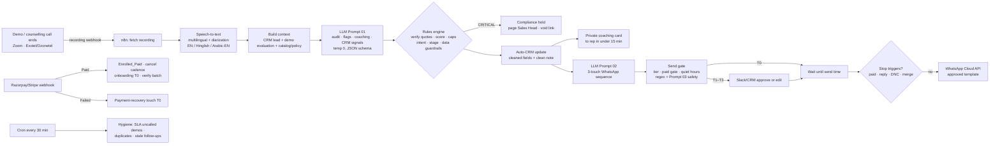

# End-to-End Workflow & CRM Automation Architecture

## Pipeline map

## Stack (no-code first, all swappable)

| Layer | Pilot choice | Why | Alternatives |
|---|---|---|---|
| Call capture | Zoom cloud recording + telephony (Exotel/Ozonetel) webhooks | Both fire a "recording ready" event | Knowlarity, Twilio |
| Speech-to-text | Deepgram Nova-3 multilingual (`language=multi`, diarize) | Handles Hindi-English code-switching; about $0.006/min | Sarvam AI (Indic), AssemblyAI, Whisper |
| Orchestration | **n8n** (self-hosted, so call data stays in our VPC) | Code nodes let us run the deterministic rules engine inline | Make, Zapier (simpler, but weaker for code) |
| LLM | Any frontier model with JSON-schema output, temperature 0, zero-retention enterprise API | Grounded extraction and strict JSON | Model choice is a config variable (`LLM_MODEL`) |
| CRM | **Google Sheets** for the pilot (`ai_cleaned_crm` tab), then LeadSquared/Zoho via HTTP node | Visible to managers on day one | HubSpot, Salesforce |
| Messaging | WhatsApp Cloud API with Meta-approved Utility/Marketing templates | Policy-compliant, and variables only are filled by the LLM | Gupshup, Interakt, WATI |
| Approvals | Slack interactive message → n8n Wait-node resume URL | One-click approve/edit | CRM task queue |
| Payments | Razorpay (India), Stripe (UAE/US/UK) webhooks | Real-time paid and failed events | – |

## Latency budget (per call)
STT about 40s → LLM audit about 20s → rules under 1s → CRM write about 2s → follow-up draft about 10s. **The CRM is updated and the coaching card sent within about 2 minutes of the call ending**, and touch 1 is ready for approval before the parent has closed Zoom.

## Files
- `n8n_post_call_pipeline.json`: the main flow (26 nodes). Import it via n8n → Workflows → Import from file.
- `n8n_payment_and_hygiene.json`: payment webhooks (paid gate, failed-payment recovery) and the 30-minute SLA/duplicate sweep.
- Environment variables: `LLM_API_URL`, `LLM_API_KEY`, `LLM_MODEL`, `DEEPGRAM_KEY`, `CRM_SHEET_ID`, `WA_PHONE_ID`, `WA_TOKEN`, `FOLLOWUP_WORKFLOW_ID`.

## Data protection
- Recording consent disclosure at the start of each call (India DPDP Act 2023; GCC/US two-party consent where it applies).
- PII minimisation: the LLM gets first names only, no phone or email. Mobile numbers are joined back only at WhatsApp send time.
- Children's data: transcripts are kept for 90 days, and only the structured CRM fields are kept after that. Enterprise LLM endpoints with zero data retention.
- WhatsApp: only to parents who opted in on the demo-booking form. STOP is honoured immediately and written to the CRM `dnc_whatsapp` field.
